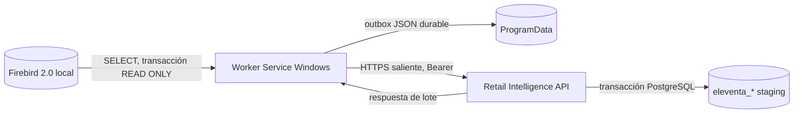

# Integración remota Eleventa → Retail Intelligence

## Estado de esta versión

Implementación de revisión en `feature/eleventa-cloud-sync`. El agente y la API compilan. El proveedor ADO.NET `FirebirdSql.Data.FirebirdClient` 10.3.4 se conectó a la copia restaurada de Firebird 2.0 y extrajo los cuatro grupos con una transacción Firebird de solo lectura. La persistencia de la API, el endpoint de catálogo, la autenticación y la idempotencia también se verificaron contra un PostgreSQL desechable de Docker usando un lote sintético por loopback. No se instaló un servicio, no se modificó la copia Firebird ni se envió información a una API remota.

La integración usa una copia del catálogo de origen en `eleventa_products` y endpoints de integración protegidos. No convierte automáticamente esos registros en `productos`: la tabla de negocio obliga a asignar departamento y proveedor PostgreSQL, pero Eleventa aporta IDs locales y muchos productos no tienen proveedor resoluble. Esa correspondencia debe hacerse con una regla explícita antes de mezclar fuentes. Las importaciones Excel y la depuración actual siguen funcionando sin cambios.

## Arquitectura



El agente no inicia un servidor HTTP ni abre puertos entrantes. `FirebirdExtractor` abre una conexión, inicia `READ | READ COMMITTED | REC_VERSION | NO WAIT`, lee el conjunto programado y cierra la transacción antes de enviar. El HTTP usa TLS del sistema y desactiva redirecciones automáticas.

## Contratos y persistencia

El contrato JSON usa `contractVersion: 1`, `sourceId`, `batchId`, `kind` y colecciones separadas. El máximo de API es 5,000 registros y 10 MiB por petición. Los lotes admitidos son:

| `kind` | Contenido | Identidad idempotente |
|---|---|---|
| `catalog` | Productos y procedencia conocida/desconocida de fechas | `source_id + source_product_id` |
| `inventory` | Fragmento de una fotografía, fecha, almacén, cantidades y total esperado | `source_id + snapshot_id + product_id + warehouse_id` |
| `sales` | Cabeceras y renglones completos de tickets, incluido estado abierto/cancelado | `source_id + ticket_id` y `source_id + line_id` |
| `returns` | Cabeceras y los renglones que Eleventa realmente expone | `source_id + return_id` y `source_id + return_line_id` |

`POST /api/integrations/eleventa/v1/batches` valida el token y el origen, el tipo, los IDs repetidos, el tamaño y las claves. Una transacción PostgreSQL persiste el contenido y el hash del lote. Repetir el mismo `batchId` y el mismo cuerpo responde como duplicado; el mismo ID con contenido distinto responde 409. Tickets existentes se actualizan por ID; los renglones que ya no aparecen se conservan y se marcan fuera de la versión vigente del ticket.

Los fragmentos de inventario quedan como incompletos hasta que el último fragmento coincide con `expectedRecordCount`. La consulta de estado sólo muestra la última fotografía completa. Los productos sin balance no reciben una cantidad inventada. Las devoluciones sin detalle se guardan a nivel de cabecera con `detail_complete = false`; no se prorratean a productos.

La identidad `PRODUCTOS.ID` y los códigos originales se conservan. Código/descripción no se normalizan. Valores ausentes o precios negativos no borran datos previamente válidos. `created_at_origin` permanece nulo porque la tabla Eleventa no tiene fecha universal fiable; `first_sale_at` y `first_inventory_movement_at` sólo guardan evidencia observada. `MONEDA` puede permanecer nula.

## API

Todas las rutas nuevas requieren `Authorization: Bearer <token>`:

| Ruta | Resultado |
|---|---|
| `POST /api/integrations/eleventa/v1/batches` | Acepta y confirma un lote. Responde 400 por datos inválidos, 401/403 por credencial, 409 por colisión de lote o snapshot. |
| `GET /api/integrations/eleventa/v1/status` | Última confirmación, lotes aceptados y fecha/tamaño de última foto de inventario completa. |
| `GET /api/integrations/eleventa/v1/catalog/products?skip=0&take=100` | Catálogo Eleventa paginado, máximo `take=500`. |

La credencial se compara por SHA-256 contra `eleventa_sources.credential_sha256` y se asocia a un único `source_id`; la base no almacena el token. La contraseña PostgreSQL que antes aparecía en `appsettings.json` se retiró y ahora se puede proporcionar con `Postgres__Password` o reemplazando la cadena completa mediante `ConnectionStrings__DefaultConnection`. Para registrar un origen, genera un token aleatorio de 32 bytes fuera del repositorio y guarda sólo su hash:

```powershell
$token = [Convert]::ToBase64String([Security.Cryptography.RandomNumberGenerator]::GetBytes(32)).TrimEnd('=').Replace('+','-').Replace('/','_')
$hash = [Convert]::ToHexString([Security.Cryptography.SHA256]::HashData([Text.Encoding]::UTF8.GetBytes($token)))
$sourceId = [Guid]::NewGuid()
"sourceId=$sourceId`ntoken=$token`nhash=$hash"
```

Inserta `sourceId` y `hash` en `eleventa_sources` usando una sesión administrativa protegida; copia el token una sola vez al archivo externo del agente. Para rotar, cambia `credential_sha256` y el token configurado juntos; el token anterior deja de ser válido inmediatamente. Para revocar, establece `is_active = false`. Las rutas preexistentes de la API no tienen autenticación configurada y CORS abierto no las protege; revisa esa superficie antes de exponer la API públicamente.

## Aplicar el esquema PostgreSQL

No hay migraciones EF en esta solución. Revisa y aplica `database/schema/03_eleventa_sync.sql` en la base de datos destino antes de desplegar la API. El script crea estas tablas, sin tocar las tablas Excel existentes:

- `eleventa_sources`, `eleventa_sync_batches`.
- `eleventa_products`.
- `eleventa_inventory_snapshots`, `eleventa_inventory_rows`.
- `eleventa_sales`, `eleventa_sale_lines`.
- `eleventa_returns`, `eleventa_return_lines`.

Haz respaldo y aplica el SQL en staging primero. La API no llama `EnsureCreated` ni modifica el esquema al arrancar.

Para almacenar los nombres de departamentos y proveedores sincronizados desde Firebird, aplica también `database/schema/05_eleventa_department_supplier_names.sql` antes de desplegar la versión de API que expone esos campos.

Para activar el umbral STOP de Pedidos Eleventa, aplica `database/schema/07_eleventa_reorder_threshold.sql` antes de desplegar esta versión de API. El valor inicial es 75% del STOP y puede cambiarse en Configuración (0–100%).

## Firebird y cuenta de lectura

El agente configura servidor, ruta, puerto, usuario, contraseña, charset y dialecto externamente. En producción, pide al administrador de Firebird que cree una cuenta dedicada y conceda únicamente `SELECT` a estas tablas, verificando las particularidades de la instalación Eleventa:

```sql
GRANT SELECT ON PRODUCTOS TO RETAIL_SYNC;
GRANT SELECT ON DEPARTAMENTOS TO RETAIL_SYNC;
GRANT SELECT ON PROVEEDORES TO RETAIL_SYNC;
GRANT SELECT ON INVENTARIO_BALANCES TO RETAIL_SYNC;
GRANT SELECT ON INVENTARIO_HISTORIAL TO RETAIL_SYNC;
GRANT SELECT ON VENTATICKETS TO RETAIL_SYNC;
GRANT SELECT ON VENTATICKETS_ARTICULOS TO RETAIL_SYNC;
GRANT SELECT ON DEVOLUCIONES TO RETAIL_SYNC;
GRANT SELECT ON DEVOLUCIONES_ARTICULOS TO RETAIL_SYNC;
```

No se ejecutaron estas instrucciones. El administrador debe validar el alta de la cuenta en la versión Firebird instalada y conceder SELECT mediante su herramienta de administración. Si la instalación no permite crear un usuario dedicado, mantén la cuenta existente, conserva la transacción `READ ONLY`, reduce el acceso a la carpeta/firewall local de Firebird y documenta la excepción antes de producción. No abras 3050 en el router ni publiques el archivo `.FDB`.

La ruta de la base de producción no está codificada. `C:\EleventaRestore\ELEVENTA_TEST.FDB` se usó sólo como copia de prueba; el archivo externo de producción debe contener la ruta real que confirme el negocio.

## Configuración externa del agente

El proyecto contiene `Eleventa.Agent/appsettings.json` con valores vacíos/de ejemplo, nunca contraseñas. En instalación, crea `C:\ProgramData\RetailIntelligence\EleventaAgent\agent.settings.json` fuera del repositorio y limita su ACL al administrador y a la cuenta de servicio. Configuración de ejemplo:

```json
{
  "Firebird": {
    "DataSource": "localhost",
    "Database": "RUTA_REAL_CONFIRMADA.FDB",
    "Port": 3050,
    "UserId": "RETAIL_SYNC",
    "Password": "CONFIGURAR_FUERA_DEL_REPOSITORIO",
    "Charset": "UTF8",
    "Dialect": 3
  },
  "Integration": {
    "SourceId": "GUID_REGISTRADO_EN_POSTGRESQL",
    "ApiBaseUrl": "https://api.dominio-del-negocio/",
    "ApiKey": "TOKEN_ALEATORIO_DE_32_BYTES",
    "IntervalMinutes": 5,
    "CatalogIntervalMinutes": 360,
    "InventoryIntervalMinutes": 60,
    "BatchSize": 100,
    "SalesLookbackDays": 90,
    "ReturnsLookbackDays": 180,
    "MaxRetries": 12,
    "StateDirectory": "%ProgramData%\\RetailIntelligence\\EleventaAgent"
  }
}
```

Variables de entorno con prefijo de configuración de .NET, como `Firebird__Password` e `Integration__ApiKey`, tienen precedencia. Reinicia el servicio después de cambiar la configuración. La URL base debe ser HTTPS y terminar en `/`.

## Ventanas, cursores y recuperación

- Revisa productos cada 6 horas y balances cada hora; ambos valores se pueden cambiar sin recompilar.
- Cada ciclo de 5 minutos pagina tickets de la ventana móvil de 90 días y devoluciones de 180 días, limitando cada página a 100 cabeceras. Reduce el tamaño si las líneas exceden el límite.
- Al iniciar una pasada se guarda su fecha inicial local para que no se mueva mientras se pagina. Al agotar la ventana, el cursor de escaneo vuelve a cero y la siguiente pasada abre una ventana nueva.
- Se pagina con IDs de ticket/devolución, pero se vuelve a recorrer la ventana solapada completa. Esto detecta registros tardíos con IDs previos y cambios de estado dentro de la ventana; datos modificados con más antigüedad que el lookback requieren aumentar la ventana o reprocesar manualmente.
- El outbox guarda JSON, reintentos, último error y cursores en `sync-state.json`. Se escribe a un temporal y se reemplaza el archivo; `agent.lock` impide una segunda instancia.
- Un cursor de escaneo avanza al confirmar el lote. El cursor `confirmed:*` guarda por separado el mayor ID confirmado. Un lote que excede los reintentos queda en revisión, se conserva completo y el escaneo puede seguir; dicho lote no se considera confirmado por el servidor.
- Tras reparar credenciales o datos, detén el servicio y ejecuta `Eleventa.Agent.exe --requeue-deadletters`; reinicia el servicio para retransmitir los lotes conservados. La API vuelve a proteger contra duplicados.
- Reintentos usan backoff exponencial con variación aleatoria, máximo configurable de 12 y tope de una hora. Lotes 400/401/403/409/413 quedan visibles como errores permanentes en el archivo local y en el log.

## Logs y estado

- Estado/outbox: `C:\ProgramData\RetailIntelligence\EleventaAgent\sync-state.json`.
- Lock de instancia: `C:\ProgramData\RetailIntelligence\EleventaAgent\agent.lock`.
- Logs por día UTC: `C:\ProgramData\RetailIntelligence\EleventaAgent\logs\agent-YYYYMMDD.log`; el agente intenta retirar archivos de más de 30 días al iniciar.
- También se registra en Windows Event Log bajo `Retail Intelligence Eleventa Sync`.
- No se escriben tokens ni cadenas de conexión en logs. Evita habilitar logs HTTP con cabeceras/cuerpos.

## Compilar, probar y publicar

Usa Windows x64 con SDK .NET 10 estable para producción:

```powershell
dotnet build RetailIntelligence.slnx
dotnet run --project RetailIntelligence.Api.IntegrationTests/RetailIntelligence.Api.IntegrationTests.csproj -- --unit
dotnet publish Eleventa.Agent/Eleventa.Agent.csproj -c Release -r win-x64 --self-contained true
```

El comando `--unit` prueba validación de contratos, IDs repetidos, límites, devoluciones sin detalle y persistencia/reintento del outbox en una carpeta temporal. Las pruebas existentes del servicio de pedidos usan PostgreSQL y sólo deben ejecutarse con la base aislada descrita en su README y variable `RETAIL_INTELLIGENCE_TEST_DB`; no se conectaron a producción.

Para comprobar el proveedor en una copia local, ejecuta los comandos desde una consola protegida configurando temporalmente `Firebird__DataSource`, `Firebird__Database`, `Firebird__Port`, `Firebird__UserId` y `Firebird__Password`, y después:

```powershell
Eleventa.Agent.exe --probe-firebird
Eleventa.Agent.exe --probe-extraction
```

Ambas opciones sólo ejecutan SELECT y no envían lotes a la API. La extracción de esta revisión comprobó 3,963 productos, 3,573 filas de balance, y emitió dos fragmentos de catálogo, dos de inventario, una página de ventas y una de devoluciones en la copia de auditoría.

## Instalar/actualizar el servicio Windows posteriormente

1. Aplica el SQL PostgreSQL, crea y valida el usuario Firebird SELECT-only, provisiona el origen/token y protege el archivo `agent.settings.json` con ACL.
2. Publica el agente y copia el contenido de `Eleventa.Agent/bin/Release/net10.0-windows/win-x64/publish` a `C:\Program Files\Retail Intelligence\Eleventa Agent`.
3. Concede a la cuenta Windows del servicio lectura/ejecución sobre el programa y modificación sólo sobre `C:\ProgramData\RetailIntelligence\EleventaAgent`. No uses `LocalSystem` si una cuenta de servicio restringida basta.
4. Desde PowerShell elevado, crea el servicio (el comando sólo se documenta; no se ejecutó):

```powershell
sc.exe create "Retail Intelligence Eleventa Sync" binPath= '"C:\Program Files\Retail Intelligence\Eleventa Agent\Eleventa.Agent.exe"' start= auto obj= "NT AUTHORITY\LocalService"
sc.exe failure "Retail Intelligence Eleventa Sync" reset= 86400 actions= restart/60000/restart/60000/restart/60000
sc.exe start "Retail Intelligence Eleventa Sync"
sc.exe query "Retail Intelligence Eleventa Sync"
```

5. Para detener antes de actualizar: `sc.exe stop "Retail Intelligence Eleventa Sync"`; respalda `sync-state.json`, reemplaza los binarios, conserva configuración/logs/estado y reinicia.
6. Para desinstalar: `sc.exe stop "Retail Intelligence Eleventa Sync"` y `sc.exe delete "Retail Intelligence Eleventa Sync"`. Elimina manualmente Program Files y, sólo si el negocio confirma que no necesita la cola ni logs, `C:\ProgramData\RetailIntelligence\EleventaAgent`.

## Limitaciones pendientes antes de producción

- La API se verificó por loopback con PostgreSQL desechable y lote sintético; falta ejecutar el agente completo contra un endpoint HTTPS accesible con la configuración real, y luego repetir en el servidor destino.
- Falta definir mapeo aprobado entre el catálogo Eleventa y las entidades globales `Productos`, `Departamentos` y `Proveedores`; por ahora el catálogo sincronizado es consultable por el endpoint protegido de integración.
- No se levantó ni instaló el servicio Windows; no se cambiaron cuentas o permisos del sistema.
- Firebird 2.0 fue verificado con el proveedor elegido en la copia local. La instalación de producción debe probarse con su usuario dedicado, ruta, arquitectura/servicio y permisos reales.
- Las ventas/devoluciones más antiguas que los lookbacks no se reconcilian automáticamente. Las 268 devoluciones sin detalle por artículo permanecen a nivel de cabecera.
- Las rutas API heredadas mantienen el estado de autenticación/CORS previo; endurecerlas requiere evaluación separada para no romper clientes existentes.

## Despliegue gratuito de demostración

El archivo `Dockerfile.api` publica la API para contenedores Linux y `render.yaml` la configura como servicio web gratuito en Render. `.dockerignore` excluye archivos `.env`, respaldos, credenciales del agente y artefactos locales del contexto Docker. La cadena `ConnectionStrings__DefaultConnection` se captura como variable secreta en el panel de Render; debe apuntar a un proyecto Supabase de prueba, nunca a `retail_intelligence` local ni a la base productiva. Render termina HTTPS en su proxy; la app procesa `X-Forwarded-Proto` para evitar redirecciones incorrectas. El frontend Vite existente espera `VITE_API_URL` con la raíz de la API (sin `/api`), configurada en el panel de Vercel.

El frontend puede continuar en Vercel para una demo personal. El plan Hobby de Vercel es sólo para uso personal no comercial. Render Free puede dormir la API después de 15 minutos sin solicitudes y su PostgreSQL gratuito vence a los 30 días; Supabase Free incluye 500 MB y puede pausar proyectos tras una semana de poca actividad. Por estas limitaciones y porque las rutas de negocio existentes aún no tienen autenticación, usa esta configuración sólo con datos ficticios y una base aislada. Consulta las condiciones actuales de cada proveedor antes de desplegar.

## Referencias oficiales

- Microsoft, [Worker Services](https://learn.microsoft.com/es-es/dotnet/core/extensions/workers) y [Windows Service con BackgroundService](https://learn.microsoft.com/es-es/dotnet/core/extensions/windows-service).
- Firebird, [ADO.NET Provider](https://github.com/FirebirdSQL/NETProvider) y [paquete NuGet FirebirdSql.Data.FirebirdClient](https://www.nuget.org/packages/FirebirdSql.Data.FirebirdClient/10.3.4). NuGet declara el paquete compatible con .NET 5 o posterior; la lectura Firebird 2.0 se validó además contra la copia local.
